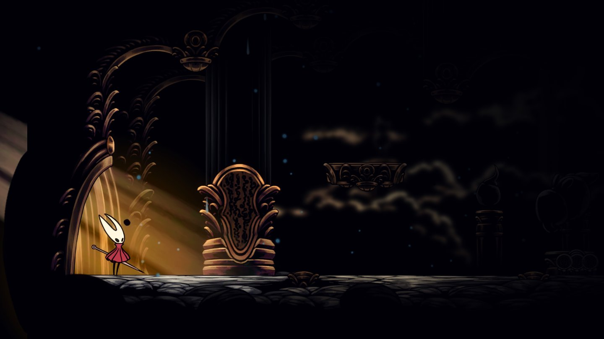
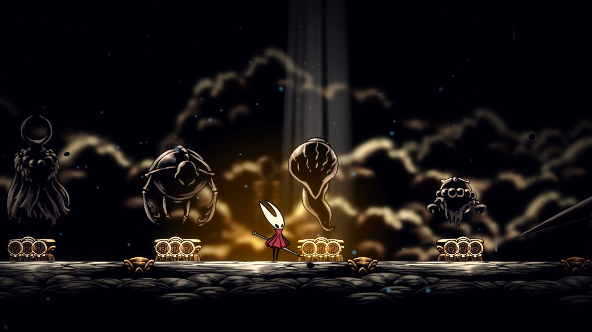
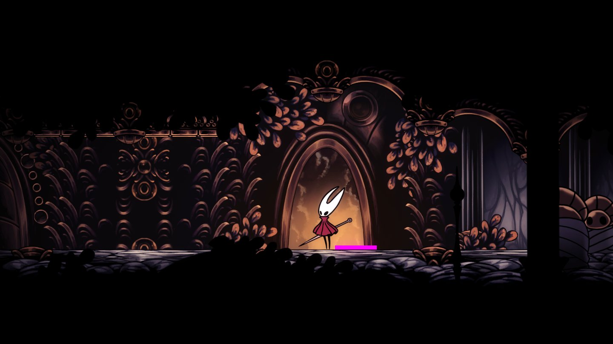
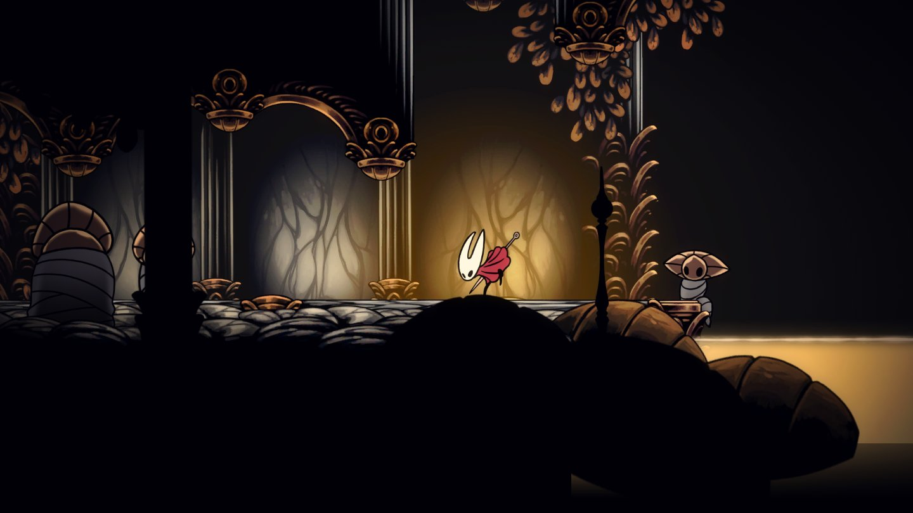

# 以前作为依赖，把前作神居搬进丝之歌：调研和试验（2026-11-24，分支 hk1-godhome）

2026-11-24 起安全规则 5（不用前作素材）、6（反编译代码不进 git）取消；其余规则照旧（不改游戏原文件，只往 BepInEx\plugins 放 dll；测试只用槽 3；不发布）。

## 结论

**可以做到，核心已经试通。**在丝之歌里原样加载了前作的手办屋（`GG_Workshop`）和前厅（`GG_Atrium`），大黄蜂能站进去走动。进出走的是游戏自己的转场，入口门、镜头、地块图、场景管理器都照常工作。前作场景里的雕像、万神殿门这些脚本，直接绑上了丝之歌里还留着的同名类（前作神居的代码丝之歌里还在，只是没有内容）。

剩下的是把它们接上本作的 Boss 和我们的战绩、万神殿，见最后的分步计划。

**更新（2026-11-24 晚）：移植做完了，见最后的“移植实现”。**前厅、屋顶、手办屋三间都接上了，巡视自检全部通过。

## 怎么做到的

**两作现在是同一个 Unity 大版本**

| 游戏 | 版本 | Unity |
|---|---|---|
| 前作（G 盘） | 1.5.12620 | 6000.0.61f1 |
| 丝之歌 | 1.0.30000 | 6000.0.50f1 |

两边的序列化格式一致，读 `UnityPlayer.dll` 和 `globalgamemanagers` 的文件头可以确认。

**运行时把前作的场景重新打包**

用的是 jakobhellermann 的 [unity-scene-repacker](https://github.com/jakobhellermann/unity-scene-repacker)（MIT）。

- 它读本机装的前作文件，把要的场景重新打包成 Addressables 资源包，外加一份目录（catalog），包里带类型树。
- 场景依赖的前作文件（`sharedassets*`、`resources.assets`、`globalgamemanagers.assets`）另外各打一个 `deps` 包。
- 丝之歌这边用它的 BepInEx 插件 [Silksong.UnitySceneRepacker](https://www.nuget.org/packages/Silksong.UnitySceneRepacker) 0.3.0（`RepackedAssets`、`RequestScene`、`RemapScript`）。插件的 dll 和原生库放在 `BepInEx\plugins\jakobhellermann-UnitySceneRepacker`，这是规则 2 允许的。

**缓存**

- 打好的包缓存在 `BepInEx\cache\unity-scene-repacker`。
- 这两个场景：32 个依赖包，共 351 MB。
- 第一次打包约 4 秒，之后直接读缓存；前作更新以后会自动重打。

**脚本怎么对上**

- 按“程序集 + 类名”找丝之歌里的同名类。因为包里有类型树，字段按名字对上，对不上的字段忽略。
- 丝之歌里没有的类，组件变成“丢失的脚本”，不会出错。
- 前作的场景管理器类叫 `SceneManager`，丝之歌改名成了 `CustomSceneManager`，用 `RemapScript` 改绑过去。

**原生转场**

- 丝之歌自己的转场（`SceneLoad.BeginRoutine`）支持直接给出场景的 Addressables 位置（`SceneLoadInfo.SceneResourceLocation`）。
- `RepackedScene.Locate()` 给的正是这个位置，所以前作场景可以像丝之歌自己的场景一样进出。

**别的模组是怎么做的**

- 你 G 盘的前作装着 **HornetInHallownest**（`Managed\Mods\IKNOWWHATIMDOING-prerelease-HornetInHallownest`），就是你说的“小骑士换成大黄蜂”那个，方向和我们相反：在前作里读丝之歌的资源。它把丝之歌的 dll 改名放进前作，并改了前作的 `ScriptingAssemblies.json`（备份是 `.hornetbak`）。
  - 我们这个方向不用改游戏文件。
- **KnightInSilksong**（小骑士进丝之歌）是另一种做法：在 Unity 编辑器里做好资源包，随模组一起发，不读前作安装。

## 实测（存档槽 3，三轮，`Debug.Hk1Probe`）

| | 手办屋 GG_Workshop | 前厅 GG_Atrium |
|---|---|---|
| 物体 | 4043 | 1828 |
| 丢失的脚本 | 2；改绑场景管理器后剩 1（`BossStatueLoadManager`） | 14 → 13 |
| 着色器出问题的 | 0（15 种） | 0（14 种） |
| FSM | 225 | 102 |
| 原生转场进场 | 10.9 秒（含第一次打包），从 `left1` 进 | 3.7 秒，从 `Door_Workshop` 进 |
| 场景大小 / 镜头边界（游戏自己按前作地块图算） | 280×80 / 265.4×71.7 | 190×90 / 175.4×81.7 |

- 标签对得上：`_SceneManager` 是 `SceneManager` 标签，地块图是 `TileMap` 标签。游戏就是按这两个标签找场景管理器和地块图的。
- 地形在第 8 层，地面碰撞照前作生效。镜头锁定区（手办屋 45 个，前厅 17 个）也照前作生效，镜头是 LOCKED 模式。
- 从前作场景发转场回大厅，神居模式照常改道回到圣所的长椅。
- 第一轮把别的场景的根物体整个关掉，截图全黑。改成只关渲染器和碰撞体以后就正常了。
- 跑完核对：存档槽 1/2/4 和备份一致（33 个文件）。槽 3 在原生转场那一轮存过一次档，可能记了前作场景当复活点，已经换回试验前的备份（当时的文件另存在 `backups\2026-11-24_132933_slot3-after-hk1-native`）。

## 前作手办屋的代码，丝之歌里还在

丝之歌的 `Assembly-CSharp` 里还留着下面这些类：

- 雕像：`BossStatue`、`BossStatueLever`、`BossStatueTrophyPlaque`、`BossStatueCompletionStates`、`BossStatueDreamToggle`
- 界面：`BossSummaryBoard` / `BossSummaryUI`、`BossChallengeUI`、`BossDoorChallengeUI`
- 万神殿：`BossSequenceDoor`、`BossSequenceController`、`BossScene`、`BossSequence`

前作场景里的 37 个 `BossStatue`、`BossSequenceDoor` 都绑上了。

现在的异常几乎都出在 `BossScene.IsUnlocked`（手办屋 84 次，前厅 4 次）。原因是前作的解锁条件读的是前作存档的字段，丝之歌的 `PlayerData` 里没有。要接上本作 Boss 的就是这里。

## 试验里看到、要处理的问题

1. **解锁和完成状态**：`BossScene.IsUnlocked`、`BossStatue.StatueState` 改成读我们的战绩（神居存档）。
2. **雕像换成本作 Boss**：
   - 雕像图换成我们已经雕好的本作石像（`StatueCarver`）。
   - 名字和描述换成本作文字（`BossStatue.bossDetails` 的文本键）。
   - 挑战走现有的场地：`door_dreamEnter` → 本作 Boss 场景 → `door_dreamReturn` 回到这尊雕像前。前作每尊雕像本来就有一扇 `door_dreamReturnGG_<雕像>` 门。
3. **数目**：前作手办屋有 36 尊（另有一个模板），我们有 50 个 Boss，有的 Boss 还有几种形态。
   - 前作雕像本来就有切换梦境版的拉杆，正好用来切换形态。
   - 不够的位置，复制雕像段把长廊加长，或者再加一层。
4. **万神殿**：前作 5 扇门，我们正好 5 个万神殿；束缚也都是 4 种。
   - 前厅这次看到 4 扇（4 个 `BossSequenceDoor`）；第 5 扇在屋顶 `GG_Atrium_Roof`，还没试加载。
   - `BossSequenceDoor` 的 `BossSequence` 换成我们的万神殿表。
   - 门牌名字和图标换成本作的；挑战界面（`BossDoorChallengeUI`）的束缚图标也换成本作的。
   - 第五个万神殿的休息点可以用前作的温泉 `GG_Spa`。
5. **前作的“神居模式返回”**：前厅一进场，就有东西发转场去 `GG_Atrium@door_dreamEnter_ReturnGGMode`。大概是看 `bossRushMode`，我们的神居存档里它是 true。要找到是哪个 FSM，拦掉或改掉。
6. **复活点**：前作的 `RespawnTrigger` 会把复活点设成前作场景。存档里不能写前作场景名，否则没装前作或插件时读档进不去。办法是存档时仍写本作大厅，读档后再转进前作前厅。
7. **前作 FSM 里丝之歌没有的动作**（`ForceHeroFootstepSound` 等）：会报警告，那一步不执行。用得到的再一个个补。
8. **小问题**：前作的 `DebugDrawColliderRuntime` 绑到丝之歌的同名类以后，画出了一条品红色的碰撞框。
9. **要求**：本机装着前作（Unity 6 的 1.5.12620）和 UnitySceneRepacker 插件。
   - 模组本身不含前作文件，素材是在本机运行时从你自己装的前作里读的，和 HornetInHallownest 一样。
   - 所以理论上同样有前作的人也能用；但发布照规则 4，要你同意。

## 分步计划

1. **接入**：
   - 全局给 `GG_` 场景提供位置（补 `SceneLoad` / `TransitionPoint` 找位置的地方），前厅、手办屋、屋顶之间的门直接能走。
   - 神居模式的大厅改成前作前厅；没装前作或插件，就退回现在的圣所。
2. **手办屋**：雕像接本作 Boss（图、名字、解锁、三档、拉杆切形态），数目扩到 50。挑战走现有场地，打完回到雕像前。
3. **万神殿**：前作 5 扇门接我们 5 个万神殿；束缚和图标换成本作的；结算、门牌、完成标记。
4. **收尾**：处理神居模式返回和复活点，清理报错；跑自检（沿用现在的 50 个 Boss 自检和万神殿自检）；Codex 审查。

## 这次加的东西

- **代码**：`src/Godhome/Experimental/Hk1Probe.cs`、`Hk1Gate.cs`。神居模式改道时放行正在试验的前作场景（`ModeController.FilterTransition` 开头）。
- **配置**：`Debug.Hk1Probe`、`Debug.Hk1ProbeMode`（additive / native / both）、`Experimental.Hk1GameDir`（留空 = 自动找）。全部默认关。
- **编译时引用**：`Silksong.UnitySceneRepacker` 0.3.0（`ExcludeAssets="runtime"`，软依赖），没装插件时模组照常加载。
- **离线试验程序**：`scratch/repacker/probe`（不进 git）。直接用 `GameRepacker` 打包这两个场景：19696 个物体，依赖 32 个文件（磁盘上 1.08 GB，打包后 349 MB），用时 13 秒。

## 移植实现（2026-11-24）

开关是 `Experimental.Hk1Godhome`（默认开）。本机找得到前作、也装了 UnitySceneRepacker 插件时，神居存档的大厅换成前作的前厅；任何一样缺了，照旧用织忆圣所。代码在 `src/Godhome/Hk1/`，大厅的分流在 `Mode/Lobby.cs`。

### 三间屋子

| 场景 | 用途 | 进出 |
|---|---|---|
| `GG_Atrium` 前厅 | 大厅；四扇万神殿的门 | 读档、死亡、放弃都回到前厅的死亡复活点（`Death Respawn Marker`）；`Door_Workshop` 进手办屋；`top2` 上屋顶 |
| `GG_Atrium_Roof` 屋顶 | 第五扇门 | `bot1` / `bot2` 回前厅 |
| `GG_Workshop` 手办屋 | 36 尊雕像放本作 50 个 Boss | `left1` 回前厅 |

- 三间之间走前作自己的门。丝之歌的转场找不到前作场景的门（`TransitionPoint.SceneGateExists`），对这三个场景直接放行。
- 去屋顶的出口和屋顶的门照前作，第五个万神殿开了才开（我们的条件：p1～p4 都完成）。前作读的 `finalBossDoorUnlocked`、`bossDoorCageUnlocked` 由我们回答（`Hk1PlayerData`）。

### 手办屋

- **数目**：`bosses.json` 的雕像表 43 尊。把同一地区、同一类的 7 对并到一尊上，正好 36 尊（`data/hk1.json`）。
  - 前作的拉杆本来就是切换梦境版雕像的，这里用来轮换同一尊上的几个 Boss，切到哪个记在神居存档里。共 13 尊带拉杆。
  - 藏在墙后的皮鬼雕像放巨蚤，最高处的辐光雕像放崇高圣母灵丝。其余按幕和表里的顺序排。
- **样子**：雕像图换成我们雕好的本作石像（第一次进手办屋在后台雕，36/36 有图，49 张约 7 秒）。
  - 前作雕像怎么做的（巡视里导出前作原图、量材质和灯）：每尊是一张专门画的**深色石料**图（亮度中位数约 0，亮的 5% 在 0.23~0.32），
    材质 `Sprites-Diffuse`（受光），每尊头顶一道光柱、两盏点光（强度 6 和 3）。手办屋环境光是黑的，雕像全靠这些灯照出迎光的边。
  - 以前我们雕的是浅色石料（中位数约 0.4），在同样的灯下一片白、像石膏，和地图不搭。
  - 现在前作神居里雕成深色石料（`StatueCarver.DarkStone`）：身体近黑，原画轮廓线全黑，迎着头顶光的面、上沿外缘、刻痕迎光的一侧是浅色细边，
    亮处带颗粒，上亮下暗、略偏暖；亮度分布按前作原图对齐。材质固定用前作的 `Sprites-Diffuse`（有的雕像的 `SpriteFadeMaterial` 会换掉，`Hk1StatueFit` 盯着换回）。
  - 原画太小的放大重雕（实心部分最少约 300 像素），不再一格一格的；石像不比原雕像宽 1.3 倍以上，免得伸出底座。
  - 织忆圣所（不受光的材质）还是浅色石料。
- **面板**：用前作的挑战面板，名字、地区、三档难度（素织 / 重织 / 断丝）换成本作的。
- **开打**：选难度后走我们现有的场地，打完、死亡、放弃都回到这尊雕像前（前作雕像自带的回程门 `door_dreamReturnGG_<雕像>`；死亡醒在它旁边的复活点）。前作底座的完成标记读我们的战绩。

### 万神殿

- 前厅四扇门对 p1～p4，屋顶的门对 p5（`data/hk1.json` 的 `doors`）。
- **门的样子**：照前作原样（五扇门长得一样，门上只有前作的束缚帽、完成帽）。以前在门洞里挂过本作的成就图标，不贴合，去掉了。
- **挑战界面**：用前作的界面。标题、说明换成本作的；四个束缚的图标、名字换成织针、面具、工具、灵丝。
  - 图标大小：前作按钮每次刷新都 `SetNativeSize()`（反编译 `BossDoorChallengeUIBindingButton`），本作的面具图原尺寸 200×327，显得特别大。
    现在第一次打开时量下前作图标的框（约 155×155），本作的图按比例缩进这个框里；刷新后再缩一次（`BindingIconSizePatch`）。
- **开门**：按“开始”后放完前作的开门动画，接上我们的万神殿连战。打完、失败、放弃都回到这扇门前。
- **死亡**：前作在万神殿里死了是梦境死亡，醒在门前（`HeroController.Die` 在 GODS_GLORY 区走梦境死亡，回程走 `bossReturnEntryGate`）。
  这里照做：每扇门、每尊雕像在回程门的落点放一个复活点（`Godhome Death Return …`），战斗中死了就在那扇门、那尊雕像前醒来，不回前厅入口。
- 锁着的门照前作显示锁；门锁界面上的图标换成要先完成的那几个万神殿。
- **休息点**：用前作神居时是前作的温泉 `GG_Spa`（和三间屋子一起重新打包），从 `door_dreamEnter` 进来，到了回满血和丝，从出口走出去就进下一场（`Hk1Spa`）。
  - 温泉里有前作的场景控制器 `BossSceneController`。照前作进下一场前设好 `SetupEvent`，不然它在 Awake 里去读存档里的前作连战、报错。
  - 不让它自己放转场（转场归 `Hk1Battle`），不让它销毁时 `RestoreBindings`（会回满血、清丝，束缚我们自己管）。
  - 它在 `Setup` 里往 `HeroController.OnTakenDamage` 挂的“受过伤”摘掉（无伤我们自己记）。
  - 入口门是“自己淡入”的门（前作由场景控制器的转场揭开），丝之歌不替它淡入：第一次实测整屏黑（场景镜头正常，界面镜头上的 `Screen Fader` 停在 `Scene Fade Out`）。到了就照丝之歌的做法淡入，1 秒、3 秒后还黑再补（`ModeController.SpaFadeIn`）。
  - 温泉的地图区是前作的编号 50，超出丝之歌场景粒子表（42 项），`SceneParticlesController.EnableParticles` 数组越界，打断镜头就位的协程。区号超出范围时当成不要场景粒子（`Hk1SceneParticlesPatch`，丝之歌自己的场景不受影响）。
  - 场景管理器的修补（`scenePools`、光照）和“不把复活点写成前作场景”原来只认三间屋子，温泉漏了（`scenePools` 空引用；温泉里也有前作长椅），改成认所有前作场景。
  - 没有前作（或温泉打包失败）时，休息点还是本作的长椅房间。
- **连战的转场特效和音效**：用前作的 `gg_battle_transitions`（`Hk1Battle`）。
  - 预制体从手办屋复仇蝇雕像回程门的 `Return from boss` FSM 参数里取（`CreateObject` 的 gameObject 参数，`ActionData` 的序列化列表）。这个物体单独打包（`RepackedAssets.Request`），不进手办屋也能用。
    - 场景文件里回程门叫 `door_dreamReturnGG`（扫前作 level470 核实，37 个），雕像醒来时才接上雕像名。第一次写成了运行时的名字，打包插件找不到这个物体就整份包失败，前作神居退回了织忆圣所。
      现在带载体的包失败时会自动不带它重新打包（另起包名），转场特效拿不到也不连累前作神居。自检加了“大厅是前作神居”“转场特效取到了”两项。
  - 特效的结构（导出 `hk1-battle-transitions.txt`）：主 FSM `Transitions`，`battle_enter` / `battle_end` / `battle_final` 三段动画，画在界面层（layer 5）的白色遮罩、梦境粒子，声音 `gg_room_transition`。
    “出去” 1.5 秒（`Transition Out Time`），FINAL 3.2 秒（`TransitionEndTime`），放完在 `Send Event` 里发 `GG TRANSITION END`。按它自己的时长等（加 1 秒余量）。
  - 前作特效放的时候关暂停，放完才开。没放完就销毁、离开时替它把暂停打开。
  - 照前作 `BossSceneController`：进战场、进温泉时，加载完就盖住（`GG TRANSITION OUT INSTANT`），人进来后揭开（`GG TRANSITION IN`）。
  - 一场打完、切场景之前放“出去”：万神殿中间 `GG TRANSITION OUT`，最后一场 `GG TRANSITION FINAL`，雕像单场 `GG TRANSITION OUT STATUE`。等它发 `GG TRANSITION END` 再切（最多等它自己的时长加 1 秒）。
  - 事件只发给自己生成的那一个（它自己的 `EventRegister`，没有就直接发给它的 FSM），不广播。
  - 看门狗：揭开后 5 秒还没放完、只盖没揭 15 秒、出去后 8 秒还在，就销毁，不会一直盖着画面。放完的照前作留在场景里，跟着场景卸载。
  - 实测（p1 自检，`tr-in` / `tr-out` / `tr-final.jpg` 放到一半的截图）：三种都画出来了（白光、梦境粒子），每场的 OUT 1.1～1.5 秒收到 END，FINAL 2.9 秒收到 END。
  - 取不到预制体就不放，照旧是丝之歌的淡入淡出。

### 存档安全

- 存档里不写前作场景：存档前把复活点、临时复活点、非致死复活点里的前作场景换回圣所的长椅（`SaveSanitizePatch`）。没装前作的人读这个档也进得去。
- 前作的 `RespawnTrigger` 全部关掉；前作 FSM 写前作存档字段的地方不写。
- 每场战斗一份快照的做法不变。

### 实机修过的问题

- **交互提示**：前作的提示预制体在丝之歌里少组件，一显示就空引用。整个 FSM 一停，玩家按上没反应。换成丝之歌自己的提示（`Hk1ShowPrompt`），能否交互也改成丝之歌的判断（`Hk1CanTalk`）。
- **交互提示都变成“交谈”**（2026-11-25，实机查明）：
  - 原因：丝之歌的转场点 `TransitionPoint` 本身是可交互物体（继承 `InteractableBase`），门型的（`isADoor`）站进去就出提示、按上就进门。前作的门型转场点自己不交互，进门和提示都由门上的 FSM 管。
    前作场景里每尊雕像前、每扇万神殿门前、温泉入口都有一个门型的入场或回程门（`door_dream…`）。读成丝之歌的转场点后，它们都能交互了。
    标签也不对：前作数据里没有丝之歌的标签字段，`InteractableBase.Awake` 把代码里旧字段 `promptLabel` 的默认值 `"Speak"` 升级成标签，就是“交谈”（反编译 `UpgradeOldSerializedFields` 核实）。
    丝之歌的交互管理器一次只显示一个提示，雕像前、门前显示的就成了回程门的“交谈”。按上还会从回程门“进门”：没有目标场景，被改道送回前厅。
  - 修法（`Hk1Lobby.FixDoors`，三间屋子和温泉共用）：
    - 入场、回程门（`door_dream…`）照前作不能交互（`SetIsInactive`，只管交互，当入口照常用）。
    - 去没搬过来的房间的门照旧关掉。
    - 剩下的真门（前厅去手办屋的 `Door_Workshop`）标签改成“进入”。
    - 所有转场点的旧字段清掉，之后醒来的也不会再变成“交谈”。
  - 实测：门前只有一个提示，写的是“挑战”（自检截图 `05-door-prompt.jpg`，检查项“门前的提示”）。
  - 先怀疑过模板 FSM 重建时丢了物体自己的“Prompt Name”，加了 `Hk1TemplatePromptPatch` 补回。日志显示 45 个模板 FSM 的值本来就对（门是 Challenge，牌子是 Inspect），这个补丁实际没有改过东西，留着当保险。
  - FSM 的提示标签另外按丝之歌的 Prompts 表核对（`Hk1Lobby.PromptKey`）：表里有就用，Ascend… / Descend… 用丝之歌的上、下，查不到的用“查看”，不会出现“#!#KEY#!#”。
- **全屏发糊**：前作的模糊背景板排序值是 0，丝之歌给它换了屏幕空间模糊材质以后盖住了前景。排到最底下。
- **前厅整体发暗、只有角色周围亮**：
  - 原因：丝之歌的场景管理器在 `mapZone` 不是 NONE、又没勾 `overrideColorSettings` 时，用丝之歌那个地图区的默认光照。前作的场景管理器没有这个开关，前作神居的地图区（50）在丝之歌里是别的区。
  - 修法：对这三个场景打开这个开关，用场景自己的环境光、色彩曲线、角色光；饱和度按前作算（前作 +0.17，丝之歌 +0.4）。
  - 手办屋前作本来就暗：环境光是黑的，靠 75 盏点光源和光柱照雕像。和网上的前作截图对比过，一致，不改。
- **场景管理器的两个空引用**：`scenePools` 前作没有；前作的环境音 `AtmosCue` 结构不同，丝之歌套用时空引用，后面的音频快照都跳过了。前者补空数组，后者在前作神居里不套用。
- **前厅一进来没声音、声音时有时无**（2026-11-26，`Hk1/Hk1Audio.cs`）：
  - 原因：前作场景的场景管理器挂的音频快照（音乐、环境、环境效果、角色、阴影）属于前作的混音器，丝之歌套用它们只动了前作的混音器。
    换场景时丝之歌把自己的角色混音器切到“暂停”，本来由场景管理器的角色快照切回来，它切的却是前作那一份，于是大黄蜂、敌人、机关一直静音；
    音乐混音器停在上一个场景的 Silent；上一个场景的环境音（熔岩场地之类）一直接着放。探针实测读档进前厅后十几秒是 -50 ~ -100 dBFS。
  - 修法：前作场景的场景管理器 Awake 时把这些快照换成丝之歌混音器里同名的（前作的照样切到前作混音器，前作场景自己的声源还走它）；
    前作音乐配置的“替代版本”结构不同，清掉；上一个场景留下的环境音停掉。修后前厅刚进场 -30 ~ -40 dBFS，和后面一样。
  - 只在这个前作房间是这次切场景的目的地（`GameManager.nextSceneName`）时换：音频是全局的，调试实验附加加载的前作房间不能停掉当前场景的环境音。
  - 同名快照找不到时设成空（场景管理器 `Start` 对每个快照都判空，跳过）。实测用到的四个房间音乐快照都找到了。
- **界面上的“!!CP3/…!!”**：前作的文本表丝之歌里没有，换成我们的文字（`Hk1Text`）。
- **坐长椅每次弹前作的护符提示**（2026-11-26，0.10.1 玩家反馈：弹小骑士打开背包换护符的提示，文字是没本地化的键）：
  - 原因：前作长椅的 `Bench Control` 坐下后进 `Charm Prompt?`，用 `PlayerDataBoolTest` 判前作的 `hasCharm`、`charmBenchMsg`，没护符或提示过就发 SKIP。
    丝之歌的 PlayerData 没有这两个字段，`PlayerDataBoolTest` 找不到字段时什么事件都不发，状态走默认的那条路，每次都生成前作的护符提示。
  - 修法：`Hk1Lobby.FixFsm` 在这个状态最前面加 `Hk1SendEvent`（结束本步、发 SKIP），后面的动作不再执行（PlayMaker 在 `IsSwitchingState` 时停止执行剩下的动作）。
  - 实测：第五万神殿自检三个休息点的长椅都直接 SKIP，不弹提示。
- **苔藓之母黑屏**（初遇 `Tut_03`、织巢双生 `Weave_03`；和前作神居无关，以前也黑）：场地东边的 `Moss Vine Cluster` 后面那片有遮罩（`Mask`，Over 层的黑块），
  要砍断藤蔓（FSM `Control` 打 4 下 → `End` 把遮罩淡掉）才揭开；原作里玩家砍开藤蔓才进得了这个场地。表里加补丁，藤蔓的 FSM 从 `Activated` 开始（等于砍过）。
  排查用的诊断留在自检里：每场记暗度、挖光的图、盖住人的物体、场景遮罩的组件和 FSM 状态（`Debugging/ViewInfo.cs`）。
- **进场弹区域名**（荒沼翼主、沙克拉弹“灰沼”，颅骨暴君入侵弹“骸底镇”；前作神居里打 Boss 不弹）：`AreaTitleController.Play` 只在存档的 `currentArea` 和本区域不同时弹，
  神居存档每场都不同。去战场、战斗、胜利、休息点这几个状态里不弹（`AreaTitlePatch`），不写存档；Boss 名字照常有，前作也有。
- **从门前、雕像前回来一直黑屏**：前作的回程门 `customFade=true`，`HeroController.EnterHeroSubFadeUp` 不调 `FadeSceneIn`，
  由门上前作的 FSM 淡入（门前 `Boss Sequence Finish` → `Fade In`，雕像前 `Return from boss` → `Transition Wait`）。它们发的事件到不了丝之歌
  HUD 上的 `Screen Fader`（`_GameCameras/HudCamera/In-game/Screen Fader`，停在 `Scene Fade Out`，黑色不透明）。
  `Hk1Lobby.FixFsm` 在这两个状态最前面加 `Hk1FadeSceneIn`（调 `GameManager.FadeSceneIn`：镜头淡入 + `SCENE FADE IN`）；
  `ModeController.Hk1FadeGuard` 兜底：回来 5 秒还停在 `Scene Fade Out` 就补一次。死后回来走复活的淡入，本来就正常。
  诊断：`ViewInfo.CameraLuma`（每台镜头单画的平均颜色）、`HudOpaque`（界面镜头上的不透明大块）、`GateFsms`（回程门的 FSM）、
  自检和巡视时记 `Screen Fader` 的状态变化和每次 `FadeSceneIn`（`Debugging/FadeTrace.cs`）。
- **万神殿结算的纹章**：结算用 `crest`、`core_glows` 图集，前作大厅原来只借了 `inventory`、`ui`、`achievement_icons_hornet`，补上（`Hk1Doors.OnArrive`）。
- **前作 FSM 的 `ForceHeroFootstepSound`**：丝之歌没有这个动作类，每轮两百多条“Could Not Create Action”。补了一个同名的空动作（`Hk1Actions.cs`，PlayMaker 按类名在所有程序集里找），那一步直接结束。

### Codex 审查（2026-11-24）和修复

审查用 gpt-6.2-astra（xhigh），10 条全部核实过。

1. **战斗中死亡卡在加载里**（实机确认，最严重）：
   - 过程：`GameManager.PlayerDead` 先按存档里的复活点（本作的长椅房间）开一个预加载（`ScenePreloader`）；我们再把复活转场改道去前厅。`SceneLoad` 要等这个预加载，而它永远不会被用上，卡死（实机 90 秒还在加载）。
   - 修法：会被改道的场景不预加载（`ScenePreloaderPatch`，判断和改道共用 `ModeController.WouldRedirect`）。改道去前厅时顺带清掉临时复活点。
   - 修后实机：死后 8.6 秒在前厅的死亡复活点醒来，存档里的复活点还是本作的长椅。
2. **前作的长椅、FSM 把复活点写成前作场景**：`PlayerData.SetString` 拦掉往三个复活点字段写前作三个房间的情况。
3. **前作房间加载失败或一直卡在转场里**：这次游戏放弃前作神居，退回织忆圣所（`Hk1Lobby.Abandon`）。
4. **前作场景管理器没改绑成功就打包**：打包前先确认改绑成功，否则不用前作神居。
5. **前作场景试验（`Hk1Probe`）在模式外启动**：只在神居模式里启动。
6. **模式重置后前作神居的状态没清**：房间都不在了就重置，下次进大厅重新决定。
7. **选好门以后的开门请求**：去前作别的房间时作废；8 秒兜底只认同一次请求，而且只在人还在前作神居、没死、没在转场时开始。
8. **去没搬过来的房间的门**：丝之歌找不到目标场景时把人送回这扇门，等于原地重进房间。前厅的蓝色房间门、屋顶的风暴之地门改成不能交互；入场、回程门不动。实机日志核对过关掉的就是这两扇。
9. **手办屋门口的总览板**：前作一尊雕像一行、名字查前作的键。改成每个本作 Boss 一行（50 行），名字和战绩用我们的。
   - 前作板上没列皮鬼的雕像（我们放巨蚤），接在最后。
   - 标题换成“忆像长廊”。
   - 前作的板按 44 行排（4 列 × 11 行），第 5 列会排到板外：改成每列 13 行，行高按比例缩，总高度不变。
   - 实机截图核对过，50 行都在板里。
10. 巡视里的测试代码只在调试开关下运行。

**复审**（同日，审这次的修复）：Codex 读到一半用量到了上限，没写完报告，只留下两条线索。我按反编译代码自己核实：

- **休息点的预加载**（真问题，已修）：万神殿的休息点里，离开都会被改道去下一场，但“会不会改道”的判断里没算休息点。休息点房间里的转场区（`SceneTransitionZoneBase`）或 FSM 的 `StartPreloadingScene` 一旦预加载，和第 1 条一样会卡死。改成休息点里一律不预加载。
- **超时放弃以后，前作房间又加载完了**：人会进一个没布置过的前作房间，随后照“迟到的到达”送回圣所。存档里的复活点本来就会清（`SaveSanitizePatch` 只看是不是神居存档）；第 2 条的拦截原来只在前作神居开着时生效，改成一直生效（丝之歌自己没有这三个场景名）。

### Codex 审查（2026-11-25）和修复

审查用 gpt-6.2-astra（xhigh，输出头核对过），审第二轮（照前作的样子）的改动。9 条都对照代码核实过，全部修了：

1. **巡视里的试验代码**：强行揭开房间遮罩的试验删掉；放弃、战斗中死亡的检查只在人还在这一场、还在战斗里时做，中途离开就中止这一项（受伤开关还原）。
2. **一次死亡调两次 `HeroController.Die`**：第二次进来时人已经是死的，不再记第二次死亡（照样走非致死的回程）。
3. **雕像、门没有回程门时**：死后复活点放在雕像、门本身那里，不再找不到复活点（复活时空引用）。
4. **回程门淡入**：只在整屏还黑着时淡入，兜底先补过、游戏自己淡入过就不再来一次。
5. **结算的纹章**：前作大厅里等纹章、闪光图集借到（最多 5 秒）再弹结算。
6. **自检的特权**：调试开关关掉、存档槽不在允许列表里时，正在跑的自检中止，“无视解锁”的特权跟着失效。
7. **门上的图标框**：离开、重新布置房间时清掉旧的记录。
8. **雕像的石料缓存**：深色、浅色两种石料分开缓存，换了就重雕。
9. **雕像贴合**：每帧都找渲染器改成记住一次，没有就停掉这个组件。

### 自检：前作神居巡视（`Debug.Hk1Tour`，槽 3）

一次跑完下面这些，截图在 `BepInEx\Godhome\shots\hk1-*`，报告是 `BepInEx\Godhome\hk1tour-*.md`：

1. 读档进前厅：站在死亡复活点，存档里的复活点还是圣所的长椅，能暂停，模糊板排在最底下。
2. 四扇门的锁和样子。
3. 第一扇门：照玩家的按法打开挑战界面，核对文字，按“开始”，进第一场，放弃，回到这扇门前。
4. 走 `Door_Workshop` 进手办屋，36 尊都换成本作石像。
5. 敲一次拉杆，换了 Boss 并记住。
6. 一尊雕像：打开面板，选重织开打，秒杀，回到这尊雕像前，雕像还能再交互。
7. 走 `left1` 回前厅；去屋顶的出口按第五扇门关着；转场去屋顶看第五扇门是锁着的。
8. 手办屋门口的总览板：照玩家的按法打开，行数等于本作 Boss 数，名字是本作的；关上后能动。
9. 战斗中死亡（开着受伤）：雕像开打死一次、万神殿开打死一次，分别在那尊雕像前、那扇门前醒来（离复活点 3 格以内），存档里的复活点还是本作场景。
10. 几尊雕像的前作原图和我们的石像对比截图、导出原图 PNG、记材质和灯（`cmp-*`、`hk1-*.png`、`ours-*.png`）。
11. 苔藓之母第一场：画面诊断（淡入淡出、黑幕、暗处、遮罩、盖住人的物体）。

### 自检：前作大厅里的单场和万神殿（2026-11-24）

- 单场自检（`Debug.AutoSelfTest`，`Experimental.Hk1Godhome=true`）：50 个 Boss 50/50。每场进场、开战各一张截图，拼 3×4 总图逐张看过。
- 万神殿自检（`Debug.SelfTestPantheon`）：大厅是前作神居时没有圣所。门开着、在这间房里就照玩家走前作的门
  （按上、在前作的挑战界面套束缚、按开始，前作的门 FSM 才会在回来时放出门动画、淡入）；门锁着才直接开始，
  第五殿没解锁也开（`StartPantheon(ignoreLock)`，只在自检里有效）。最后核对站回这扇门前的复活点旁边。
  第五殿（直接开始）47/47、检查 14/14，站回屋顶第五扇门前（离门 0.9 格）；第一殿走门 10/10。
- 连界面截图（`Shots.CaptureWithUi`）先把临时图清黑。已知：读档后头一两张偶尔截到开机时的标题菜单（显存旧画面），
  那时 `_UIManager/UICanvas` 上没有看得见的图形（`ViewInfo.UiVisible`），玩家看不到；试过不碰 `Darkness Camera`，没用，撤回。

### 自检：温泉、连战转场、门的提示（2026-11-25）

- 万神殿自检（槽 3，`selftest-20261125_091619`）：第一殿走门，第 1 场后加温泉休息点（`Debug.SelfTestPantheonRestAfter=1`），10/10，检查全部通过。
  新加的检查：“大厅是前作神居”（打包失败退回圣所时会报失败）、“前作连战转场特效”（载体找到了）、“休息点是前作温泉”、
  “门前的提示”（看得见的 `PromptMarker` 正好一个，文字等于 `Prompts/CHALLENGE`，不是 `SPEAK`；截图 `05-door-prompt.jpg`）。
- 前作神居巡视回归（槽 3，`hk1tour-20261125_092244`）：全部通过。雕像赢了回来的一瞬间，界面镜头上有一份
  `gg_battle_transitions(Clone)` 停在 `Out Instant`（不透明的白光），这是前作雕像自己的 `Return from boss` FSM 放的，不是我们的；
  7 秒后界面镜头上没有不透明的东西，截图 `36-back-at-statue-7s.jpg` 雕像前画面正常、“挑战”提示在，雕像还能交互。

### 温泉的长椅、转场动画被剔除（2026-11-25）

- 温泉的长椅（`RestBench (1)` / `Bench Control`）：前作 FSM 用的 HeroController、GameManager 方法丝之歌都有（只有 `flashBenchRest` 没有，SendMessage 不要求接收者，没事）；
  动画名和丝之歌自己的长椅 FSM 一样（Sit、Get Off、Sit Idle……，读丝之歌 `Tut_03` 的长椅 FSM 核实）。`Set Respawn` 在温泉布置时关掉（复活点名会写成 `RestBench (1)`）。
  自检（万神殿第 1 场后的休息点）照玩家坐一次再起来，6 项都过。
- 转场动画被剔除：`gg_battle_transitions` 的三个 Animator 都是 `CullCompletely`。画在界面镜头上的白底，有时被判成看不见，揭开的动画就停在开头，白底一直盖着
  （温泉实测 6 轮里 4 轮，10 秒左右才褪）。生成时改成 `AlwaysAnimate`；`Hk1Battle.RevealWatch` 兜底：揭开时长 + 0.75 秒后白底还在，就关掉揭开的那组图。
  自检的休息点检查加了界面镜头的覆盖比例（`ViewInfo.HudCover`）。

### 还剩的

- **日志噪声**（不影响功能）：
  - 前作文本表 `CP3` 查不到，每轮五条左右；界面上的字已经换掉。
  - 进前厅时有一条“GameObject is already being activated or deactivated”：Unity 不给调用栈，门笼已经推迟一帧关；猜是前作 FSM 自己的激活动作，没再深挖。
  - 前作 FSM 调 `GameManager.SaveGame`（参数个数不对）、`ClearMPSendEvents`。
- **没有实机看过的**：休息点里不预加载（复审的修复，只编译过；休息点房间里本来就很少有预加载）；关上的两扇门按上键没反应（日志核对过关掉了，没去按）；p5 真的开了以后从 `top2` 走上屋顶（巡视里 p5 锁着，是转场过去的）；连战打赢以后门上的完成标记。
- **前作的神居侍者、钟、奖杯台**等装饰原样留着，没有交互。
